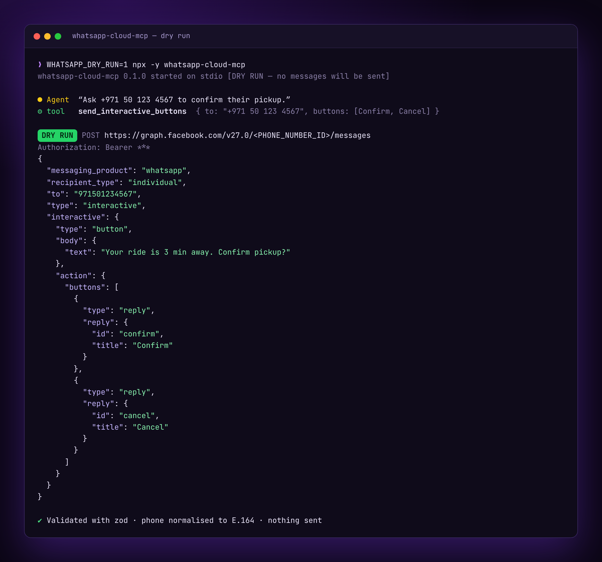

# whatsapp-cloud-mcp

> A Model Context Protocol (MCP) server for the official **WhatsApp Cloud API** — let Claude, Cursor and any AI agent send WhatsApp text, templates, media and interactive messages.

[](https://github.com/workofhaseeb-cyber/whatsapp-cloud-mcp/actions/workflows/ci.yml)
[](./LICENSE)
[](https://nodejs.org)
[](https://www.typescriptlang.org/)
[](https://modelcontextprotocol.io)



## Why

AI agents are great at *deciding* what to say — but giving them a safe, typed bridge to a real messaging channel is the hard part. `whatsapp-cloud-mcp` wraps the official WhatsApp Cloud API as a set of well-described MCP tools so an LLM can:

- send messages from natural-language instructions, with phone numbers normalized to E.164 automatically;
- use **approved templates** to legitimately start conversations;
- preview every request with **dry-run mode** before a single message leaves your machine;
- receive and react to incoming messages via the included **webhook helpers**.

It is built to be correct about WhatsApp's rules (the 24-hour customer-service window, template requirements, media limits) and friendly to LLMs (rich tool descriptions, actionable error hints).

## Features

- **9 MCP tools**: text, template, media, interactive buttons, interactive list, mark-as-read, list templates, business profile, upload media.
- **E.164 phone normalization** — accepts `+971 50 123 4567`, `00971...`, national numbers (with a default country code), and WhatsApp JIDs.
- **Dry-run mode** — returns the exact request (with the token redacted) without calling the network. Perfect for demos, CI and prompt engineering.
- **Actionable errors** — Graph API error codes are mapped to human hints (expired token, outside 24h window → use a template, rate limits, unapproved template, …).
- **Webhook toolkit** — signature verification, the verification handshake, and a normalizer that flattens WhatsApp's nested payload into a clean discriminated union.
- **Usable as a library** — import the builders, client and webhook helpers directly.
- **Strict TypeScript, zod schemas, 60+ tests.**

## Quick start

### Run with npx

```bash
npx -y whatsapp-cloud-mcp
```

> The npm release is coming soon. Until then, run it straight from GitHub: `npx -y github:workofhaseeb-cyber/whatsapp-cloud-mcp` (it builds on install), and use those same args in the configs below.

### Claude Desktop

Add to `claude_desktop_config.json` (macOS: `~/Library/Application Support/Claude/claude_desktop_config.json`):

```json
{
  "mcpServers": {
    "whatsapp": {
      "command": "npx",
      "args": ["-y", "whatsapp-cloud-mcp"],
      "env": {
        "WHATSAPP_ACCESS_TOKEN": "EAAG...",
        "WHATSAPP_PHONE_NUMBER_ID": "1234567890",
        "WHATSAPP_BUSINESS_ACCOUNT_ID": "1234567890",
        "WHATSAPP_DEFAULT_COUNTRY_CODE": "971"
      }
    }
  }
}
```

### Cursor

Add to `.cursor/mcp.json` in your project (or the global `~/.cursor/mcp.json`):

```json
{
  "mcpServers": {
    "whatsapp": {
      "command": "npx",
      "args": ["-y", "whatsapp-cloud-mcp"],
      "env": {
        "WHATSAPP_ACCESS_TOKEN": "EAAG...",
        "WHATSAPP_PHONE_NUMBER_ID": "1234567890",
        "WHATSAPP_BUSINESS_ACCOUNT_ID": "1234567890"
      }
    }
  }
}
```

> Tip: set `"WHATSAPP_DRY_RUN": "1"` in `env` while you wire things up — no messages will actually be sent.

### From source

```bash
git clone https://github.com/workofhaseeb-cyber/whatsapp-cloud-mcp.git
cd whatsapp-cloud-mcp
npm install
npm run build
node dist/index.js
```

## Getting credentials

In [Meta for Developers](https://developers.facebook.com/):

1. Create an app (type **Business**) and add the **WhatsApp** product.
2. In **WhatsApp → API Setup**, copy the **Phone number ID** and the **WhatsApp Business Account ID**.
3. Generate an access token. For development the temporary token works; for production, create a **System User** with a long-lived token and grant it `whatsapp_business_messaging` (and `whatsapp_business_management` for templates).
4. Add and verify a recipient test number, or register your own number to go live.
5. (Optional) For webhooks, copy the **App Secret** (App → Settings → Basic) into `WHATSAPP_APP_SECRET`.

## Tool reference

| Tool | What it does | Key parameters |
| --- | --- | --- |
| `send_text_message` | Send a plain text message (inside the 24h window) | `to`, `body`, `preview_url?`, `reply_to_message_id?` |
| `send_template_message` | Send an approved template (required to start a conversation) | `to`, `template_name`, `language_code`, `body_parameters?` / `components?` |
| `send_media_message` | Send image/video/audio/document/sticker by link or `media_id` | `to`, `media_type`, `link?` / `media_id?`, `caption?`, `filename?` |
| `send_interactive_buttons` | Send up to 3 quick-reply buttons | `to`, `body`, `buttons[]`, `header?`, `footer?` |
| `send_interactive_list` | Send a tappable list menu (≤10 rows) | `to`, `body`, `button_text`, `sections[]` |
| `mark_as_read` | Mark an incoming message read (+ optional typing) | `message_id`, `show_typing?` |
| `list_message_templates` | List templates with status/category/language | `limit`, `status?`, `name?` |
| `get_business_profile` | Fetch your public business profile | — |
| `upload_media` | Upload a file/URL, get back a reusable `media_id` | `file_path?` / `url?`, `mime_type?` |

## Environment variables

| Variable | Required | Default | Description |
| --- | --- | --- | --- |
| `WHATSAPP_ACCESS_TOKEN` | to send | — | Cloud API access token |
| `WHATSAPP_PHONE_NUMBER_ID` | to send | — | Sender phone-number ID |
| `WHATSAPP_BUSINESS_ACCOUNT_ID` | for templates | — | WABA ID (needed by `list_message_templates`) |
| `WHATSAPP_API_VERSION` | no | `v27.0` | Graph API version |
| `WHATSAPP_DEFAULT_COUNTRY_CODE` | no | — | Country code for national numbers (e.g. `971`) |
| `WHATSAPP_DRY_RUN` | no | `0` | `1`/`true` to preview requests without sending |
| `WHATSAPP_UPLOAD_DIR` | no | — | Directory whose files `upload_media`'s `file_path` may read; unset disables local-file uploads |
| `WHATSAPP_TIMEOUT_MS` | no | `15000` | Per-request timeout in ms |
| `WHATSAPP_GRAPH_BASE_URL` | no | `https://graph.facebook.com` | Graph base URL (override for proxies/mocks) |
| `WHATSAPP_APP_SECRET` | webhook | — | App secret for webhook signature verification |

## Dry-run demo

With `WHATSAPP_DRY_RUN=1`, asking the agent *"Send a WhatsApp to +971 50 123 4567 saying 'Your order has shipped'"* calls `send_text_message` and returns:

```json
{
  "to": "971501234567",
  "message_id": null,
  "status": "dry_run",
  "response": {
    "dry_run": true,
    "method": "POST",
    "url": "https://graph.facebook.com/v27.0/<PHONE_NUMBER_ID>/messages",
    "headers": { "Authorization": "Bearer ***" },
    "body": {
      "messaging_product": "whatsapp",
      "recipient_type": "individual",
      "to": "971501234567",
      "type": "text",
      "text": { "body": "Your order has shipped", "preview_url": false }
    }
  }
}
```

No network call is made and the token is redacted — safe to run anywhere.

## Webhook helper usage

```ts
import { createServer as createHttpServer } from "node:http";
import {
  loadConfig,
  WhatsAppClient,
  verifyWebhookSignature,
  handleVerificationRequest,
  parseWebhookPayload,
  buildTextMessage,
  buildMarkAsRead,
} from "whatsapp-cloud-mcp";

const client = new WhatsAppClient(loadConfig());
const appSecret = process.env.WHATSAPP_APP_SECRET!;

// GET: echo the challenge during subscription
handleVerificationRequest(new URLSearchParams(req.url!.split("?")[1]), "my-verify-token");

// POST: verify the raw body, then react to events
if (verifyWebhookSignature(rawBody, req.headers["x-hub-signature-256"], appSecret)) {
  for (const event of parseWebhookPayload(JSON.parse(rawBody))) {
    if (event.kind === "message" && event.text?.toLowerCase() === "ping") {
      await client.markAsRead(buildMarkAsRead({ message_id: event.id }));
      await client.sendMessage(buildTextMessage({ to: event.from, body: "pong" }));
    }
  }
}
```

A complete, runnable example lives in [`examples/webhook-server.ts`](./examples/webhook-server.ts).

## Use as a library

```ts
import {
  buildTemplateMessage,
  WhatsAppClient,
  loadConfig,
  normalizePhoneNumber,
} from "whatsapp-cloud-mcp";

const client = new WhatsAppClient(loadConfig());

const payload = buildTemplateMessage(
  { to: normalizePhoneNumber("050 123 4567", { defaultCountryCode: "971" }), template_name: "hello_world", language_code: "en_US" },
);

const res = await client.sendMessage(payload);
console.log(res);
```

## Security notes

- **Never commit `.env`** or tokens. Pass secrets via environment variables (`.env` is git-ignored).
- **Least privilege**: prefer a long-lived **System User** token scoped to only `whatsapp_business_messaging` (and `whatsapp_business_management` for templates).
- **Use dry-run** (`WHATSAPP_DRY_RUN=1`) when developing or letting an untrusted prompt drive the tools — nothing is sent and tokens are redacted in output.
- **Sandboxed uploads**: `upload_media` can only read local files inside `WHATSAPP_UPLOAD_DIR` (symlinks and `..` are resolved first) and is disabled when that variable is unset. Remote uploads must be `https://`, private/loopback/link-local IP hosts are refused and redirects are not followed, which limits SSRF. Hostnames that resolve to private IPs are not checked, so run the server where that matters.
- **Verify webhook signatures** with `verifyWebhookSignature` over the *raw* request body (constant-time compare) before trusting any payload.
- **Respect the rules**: free-form messages are only allowed within the 24-hour customer-service window; outside it you must use an approved template. Obtain opt-in and follow the [WhatsApp Business Messaging Policy](https://business.whatsapp.com/policy).

## Development

```bash
npm install
npm run build      # compile to dist/
npm run dev        # compile in watch mode
npm run typecheck  # tsc --noEmit
npm run lint       # eslint .
npm test           # vitest run
```

## Roadmap

- Streamable HTTP transport (in addition to stdio)
- WhatsApp Flows
- Catalog / product messages
- Reactions and location messages
- Built-in rate-limit retry/backoff
- Expose incoming webhooks as MCP resources/notifications

## Contributing

Issues and PRs are welcome. Please run `npm run lint && npm run typecheck && npm test` before opening a PR, and keep changes focused and well-tested.

## License

[MIT](./LICENSE) © Haseeb Ur Rehman

## Author

**Haseeb Ur Rehman** — Applied AI Engineer & Full-Stack Tech Lead, Abu Dhabi.

- Website: https://www.lifeofhaseeb.com
- LinkedIn: https://www.linkedin.com/in/haseeburrehman-ai
- GitHub: https://github.com/workofhaseeb-cyber

---

> This project is an independent, community-built integration and is **not affiliated with, endorsed by, or sponsored by Meta or WhatsApp**. "WhatsApp" is a trademark of Meta Platforms, Inc.
